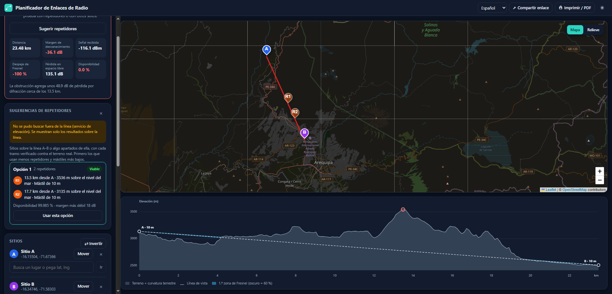
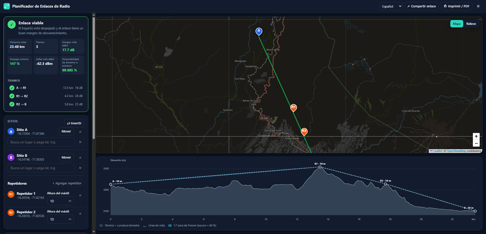

# Radio Link Planner

A modern, accurate point-to-point radio link planner that runs in the browser.
Drop two sites on a map and see, in seconds, whether a wireless link will work: terrain profile, Fresnel zone, link budget and estimated availability, explained in plain language.

It loads real elevation data between the two sites, checks whether the terrain and the curvature of the earth block the path, and estimates the received signal and how many hours a year the link will be up.
When the answer is "no", it does not stop there: it tells you how much taller the masts must be, or, if that is not enough, proposes up to two repeater sites and verifies each hop on the real terrain.
Everything runs in your browser, nothing is installed and nothing is stored on a server: the whole scenario lives in the URL, so you can share it or print it.
It is meant for quick, honest feasibility checks before a site survey, not as a replacement for field measurements.

> Most online link calculators are dated, cramped and hard to trust. This one aims to be the opposite: clear, fast, and honest about its assumptions.

📡 **Try it now: https://franco0209.github.io/radio-link-planner/**

<p align="center">
  <br>
  <sub><b>A blocked 23 km link:</b> the tool proposes verified repeater sites, ranked by fewest repeaters and lowest masts.</sub>
</p>

<p align="center">
  <br>
  <sub><b>The same route with the suggestion applied:</b> three hops, each checked against the terrain, 99.985 % end-to-end availability.</sub>
</p>

## Project status

In active development since **October 2026**: about a month of research on propagation models, terrain data and UX, followed by this first working version. The roadmap below shows what is next.

## Features

- **Map first.** Place sites A and B by clicking, dragging pins, searching a place name or pasting `lat, lng`. Street and topographic map styles.
- **Real terrain.** Elevation profile from the Copernicus 90 m DEM, sampled about every 120 m. Southern Peru around Arequipa (lat −18° to −15°, lng −73° to −70°) is bundled with the app, so it loads instantly and makes **no API calls**; anywhere else falls back to the Open-Meteo elevation service.
- **Fresnel zone and earth curvature.** The profile shows terrain with earth bulge (configurable k-factor), the line of sight and the first Fresnel zone, with the 60 % core highlighted.
- **Plain-language verdict.** *Viable*, *Marginal* or *Will not work*, with the reason and the fix. Never colour alone: every state has an icon and a label.
- **"How high do I need to build?"** Finds the smallest equal mast-height increase that reaches 60 % Fresnel clearance, applied with one click.
- **Link budget.** EIRP, free-space loss, diffraction loss from the worst obstruction, received level, fade margin and yearly availability (Vigants-Barnett).
- **Repeaters, never the first option.** Add up to 2 repeaters by hand at any time (click the map, drag them anywhere, set each mast height). If a link is blocked, a **Suggest repeaters** button appears below the "raise the masts" fix. It searches the A–B line using the terrain already loaded (no extra elevation requests) and, if that is not enough, looks for one repeater in a corridor beside the line with a small number of extra requests, and ranks options by fewest repeaters, then lowest mast, then end-to-end availability. Each hop gets its own verdict and colour, and the route reports the weakest hop and the end-to-end availability.
- **Linked chart and map.** Hover (or use the arrow keys on) the profile and the exact spot lights up on the map.
- **Shareable.** The whole scenario lives in the URL. Copy the link, bookmark it, or print a one-page PDF report.
- **Three languages.** English, Español and Português, detected from the browser and switchable from the header. Text in the core is never hard-coded: results are structured and phrased by the UI.
- **Accessible and responsive.** Keyboard operable, labelled controls, light and dark themes, works on phones.

## How the repeater search works

This is the part that sets the project apart: a blocked link gets a **verified repeater plan**, not a guess.

Evaluating one candidate is closed-form physics (terrain, earth bulge, Fresnel, diffraction, link budget). Only *where to put the repeaters* is combinatorial, and that space is small and discrete, so the search is **deterministic and exhaustive over a discretised candidate set**, organised as iterative deepening with memoisation.

**Algorithmic paradigm, at a glance**

| Stage | Paradigm | Exact? |
|---|---|---|
| Repeaters **on** the A–B line | **Exhaustive search (brute force) over a bounded candidate set**, with iterative deepening (fewest repeaters, then lowest mast) and memoisation (light dynamic programming) | Optimal for 1 repeater, and for 2 when `C ≤ 90`. Above that the candidate set is pruned (thinning plus local peaks), not the scoring |
| One repeater **off** the line | **Heuristic funnel (filter and refine)**: restrict to an elliptical corridor, coarse grid, pre-score on interpolated terrain with no network, then verify only the best few on real terrain | No. A narrow peak between grid nodes can be missed. Whatever it reports was verified on real terrain |

It is **not** a greedy, divide-and-conquer or genetic/metaheuristic algorithm: there is no randomness, and nothing is decided by committing to a locally best step. The only greedy-like part is the stopping rule (stop at the first layer that has a viable route).

**Input**

- The A–B terrain profile already loaded: `n` samples (distance, ground elevation, coordinates), `n ≤ 400`, about one every 120 m.
- Radio parameters: frequency, TX power, antenna gains, cable losses, receiver sensitivity, k-factor, terrain factor, extra losses, and the masts at A and B.
- Options: repeater mast ladder (10, 15, 20, 30, 45 m), minimum hop length, number of results.

**Output**: up to 3 options, each with the repeater sites (coordinates, distance from A, ground elevation, mast height), end-to-end availability, weakest-hop fade margin and hop lengths.

**Algorithm**

```
for count in [1, 2]:                       # fewest repeaters first
  for h in [10, 15, 20, 30, 45]:           # lowest mast first
    for each candidate site (or pair) on the A-B line:
      split the profile into hops          # each hop is a slice of the same samples
      score every hop with the same analyzer as a single link
      route is "viable" if every hop has 60 % Fresnel clearance and a 15 dB fade margin
    if any viable route exists:
      return the best 3, ranked by end-to-end availability then weakest-hop margin,
             kept at least 8 % of the path apart
fallback: best partial improvements (marginal), else "no solution on the line"
```

Why this ordering: a solution with one repeater is never replaced by one with two, and a shorter mast is cheaper to build. Within that, availability decides.

**Complexity**

`n` = samples, `C ≤ n` = candidate sites, `P ≤ 90` = candidates used for pairs, `H = 5` mast heights. Scoring one hop is `O(n)` (no iterative height search inside the loop).

| Case | Time | Notes |
|---|---|---|
| 1 repeater | `O(H · C · n)` = `O(H · n²)` | Every sample is a candidate; each needs 2 hop evaluations |
| 2 repeaters | `O(H · P² · n)` | Hops from A and to B are memoised, so only the middle hop is new per pair. Without the cap on `P` it would be `O(H · n³)` |
| Memory | `O(P² + n)` | Memo table and cached slices |
| Best case | `O(C · n)` | Stops at the first mast height with a viable single repeater |

Measured on a desktop: about **20 ms** for the real Arequipa → Chiguata example, **under 600 ms** in the worst case (400 samples and nothing viable, so every pass runs). The on-line search runs without blocking the interface and makes **no extra elevation requests**.

**How exact is it?**

- **1 repeater: optimal** over the sampled positions.
- **2 repeaters: optimal when `C ≤ 90`.** Above that the candidate set is pruned (even thinning plus the highest local peaks, because a ridge top is the classic site). The pruning is on *where to look*, never on how a route is scored.
- Both claims are checked in the test suite against an independent brute force that goes through the public route API.
- Limits: positions are on the straight A–B line and on a ~120 m grid, and fading on different hops is assumed independent.

**Off the line (heuristic).** If the line search finds no single viable repeater, a second stage looks for one repeater beside the line. Each site off the line needs new terrain from the elevation service, which rate-limits, so the goal is to fetch as little as possible: (1) allow only sites with `|AR| + |RB| ≤ 1.15 · |AB|` and at most 20 % of `|AB|` off the line; (2) fetch a 20 × 9 grid over that corridor (2 requests); (3) pre-score every node on terrain interpolated from the grid, with no network; (4) fetch real terrain for the best 5 sites, one at a time, and stop once 3 are confirmed viable. That is roughly 10 to 25 requests instead of hundreds. Details in [docs/METHODOLOGY.md](docs/METHODOLOGY.md#8-repeaters-and-multi-hop-routes).

**A graph view, for later.** Treat candidate sites as nodes and a viable hop as an edge weighted `−ln(availability)`. Then "at most k repeaters" is a hop-limited shortest path, `O(k · E)` once the `O(C² · n)` edges are computed. That removes the exponential growth and is how the tool can go past 2 repeaters. See [docs/METHODOLOGY.md](docs/METHODOLOGY.md#8-repeaters-and-multi-hop-routes).

## How it computes

| Quantity | Method |
|---|---|
| Distance, path sampling | Haversine and great-circle interpolation |
| Free-space path loss | `32.44 + 20·log10(d km) + 20·log10(f MHz)` |
| Fresnel radius | `17.32 · sqrt(d1·d2 / (f GHz · d))` |
| Earth bulge | `d1·d2 / (12.74·k)` with k = 4/3 by default |
| Obstruction loss | Single knife edge, ITU-R P.526 approximation, using the worst point |
| Availability | Vigants-Barnett multipath model with terrain factor |

Details, assumptions and limits are in [docs/METHODOLOGY.md](docs/METHODOLOGY.md).

**This is a planning aid, not a survey.** Always verify a link on site before buying hardware.

## Run it

```bash
npm install
npm run dev      # http://localhost:5173
npm test         # unit tests for the calculation core
npm run build    # production build in dist/
```

The scenario is stored in the URL hash, for example:
`#a=-16.39890,-71.53500&b=-16.40200,-71.40100&heightAM=60&heightBM=60`

## Project layout

```
src/
  core/         Pure TypeScript radio maths (no UI, fully unit-tested)
  services/     Elevation and place-search clients
  state/        URL (de)serialisation
  i18n/         English / Spanish / Portuguese dictionaries (typed against English)
  components/   Map, profile chart, results, forms
```

Adding a language means adding one file typed as `Dict`: the compiler lists every missing string.

The calculation core has no dependency on React or the DOM, so it can be reused in a CLI, an API or a future mobile app.

## Tech

React 19, TypeScript, Vite, Leaflet, Vitest. The chart is hand-written SVG, so there is no charting dependency.

## Roadmap

- [x] Repeaters (up to 2): manual placement and suggestions along the A–B line
- [x] Repeater search off the A–B line (one repeater, corridor heuristic)
- [ ] Two repeaters off the A–B line
- [ ] More than 2 repeaters and per-repeater equipment
- [ ] Equipment library with real radio datasheets
- [ ] Rain fading for licensed bands (ITU-R P.838 / P.530)
- [ ] Obstruction heights from building and tree layers
- [ ] Export KML for Google Earth
- [ ] Offline mode with cached tiles and terrain

## Data and attribution

Terrain: Copernicus DEM GLO-90 through [Open-Meteo](https://open-meteo.com/). Maps: © OpenStreetMap contributors and OpenTopoMap (CC-BY-SA). Place search: Nominatim. Please respect their usage policies if you deploy this publicly.

## License

MIT
